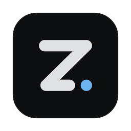
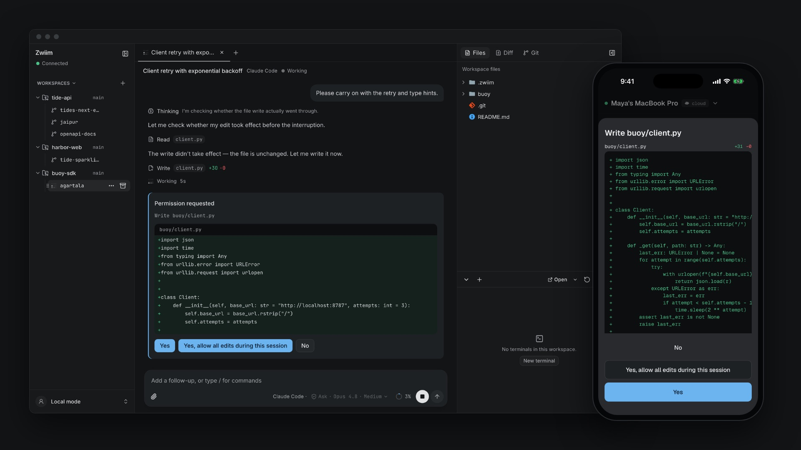
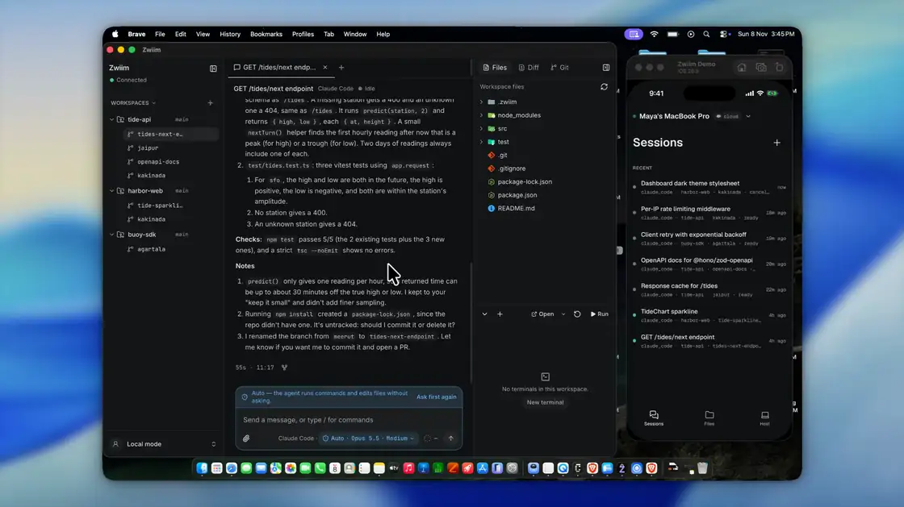
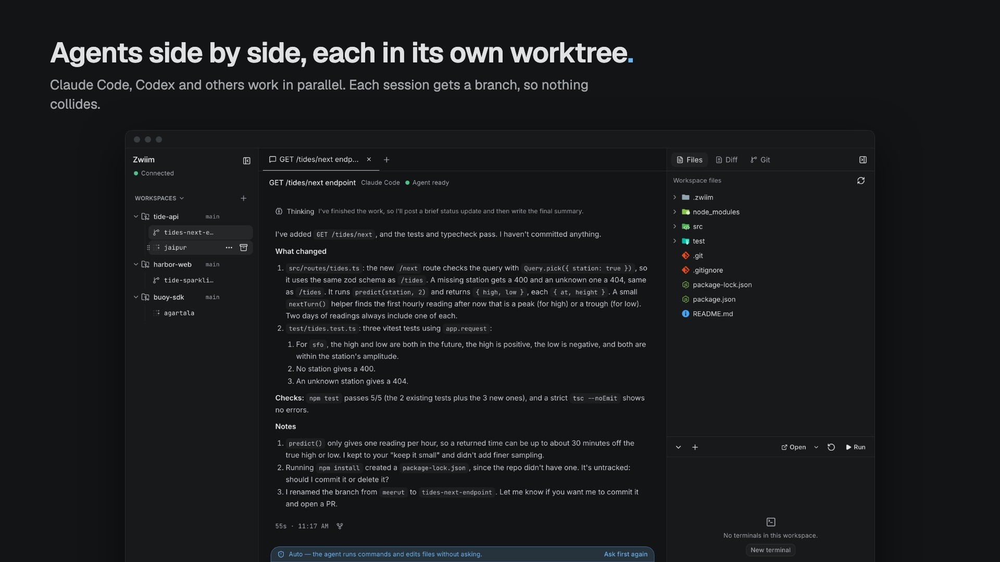
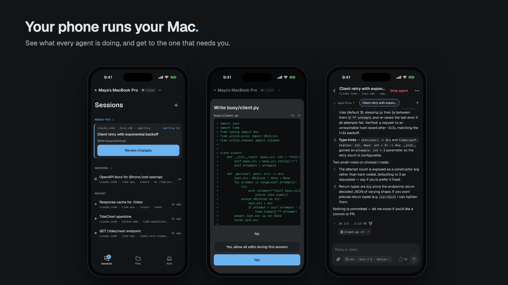
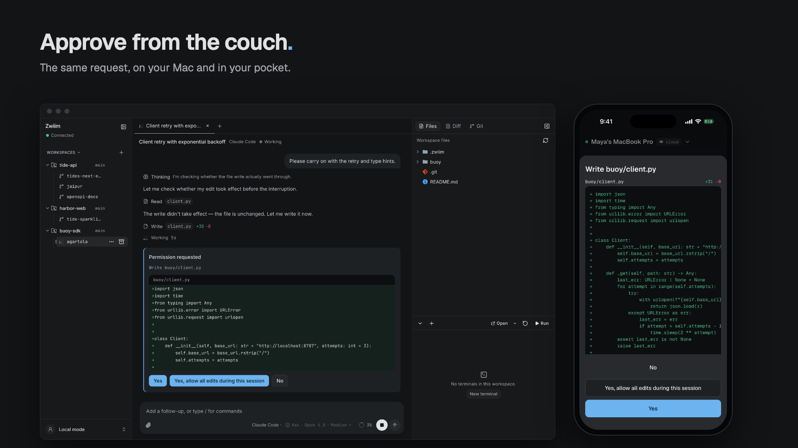
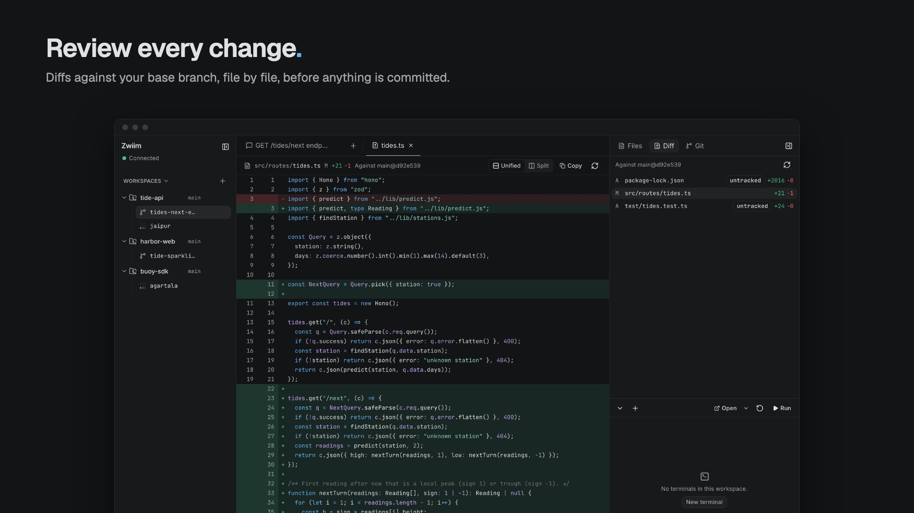
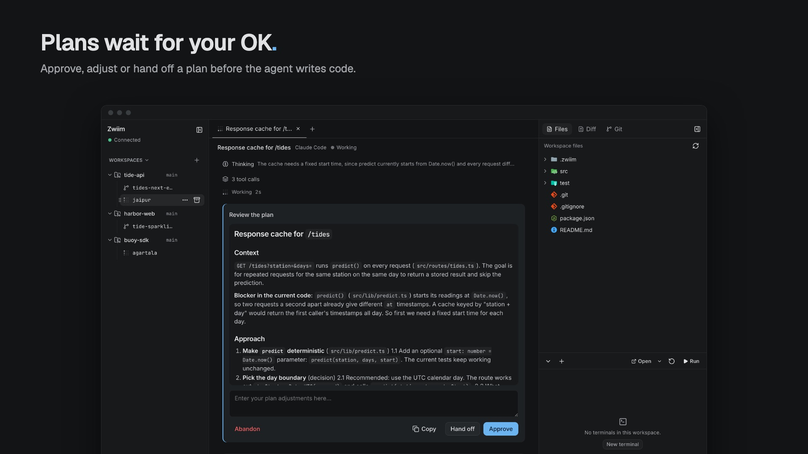
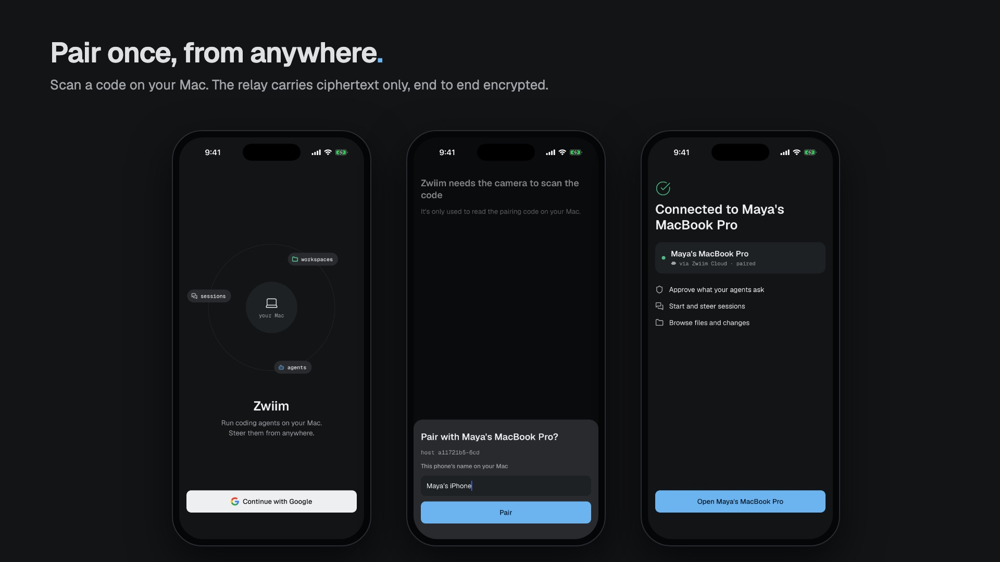

<h1 align="center">
   Zwiim
</h1>

<p align="center">
  <a href="LICENSE"></a>
  <a href="https://github.com/zwiim/zwiim/releases"></a>
  
  
</p>

<p align="center">
  <strong>Your Mac runs the agents. Your phone runs your Mac.</strong><br/>
  Run Claude Code, Codex and other coding agents side by side on your own machine,
  each in its own Git worktree. Approve, follow and answer them from your Mac or your phone.
</p>

<h3 align="center"><a href="https://github.com/zwiim/zwiim/releases"><ins>Download Zwiim</ins></a></h3>

<p align="center">
  
</p>

> **Status: release candidate.** Expect rough edges. The Mac app runs on Apple
> Silicon only for now.

## See it in 15 seconds

<p align="center">
  <a href="docs/assets/readme/demo.mp4"></a>
  <br/><sub>Recorded live with Recordly on the Mac and the iPhone app, sped up 1.8×. <a href="docs/assets/readme/demo.mp4">Watch in full quality (MP4)</a></sub>
</p>

## Features

<table>
<tr>
<td width="45%" valign="middle">

### Agents side by side

Start several agents at once. Each session gets its own worktree and branch, so
they never step on each other. Zwiim renames the branch to match the work.

</td>
<td width="55%"></td>
</tr>
<tr>
<td width="45%" valign="middle">

### Your phone runs your Mac

See every session at a glance. The ones waiting for you are at the top, with
what they want to do and a button to review it.

</td>
<td width="55%"></td>
</tr>
<tr>
<td width="45%" valign="middle">

### Approve from anywhere

When an agent asks to edit a file or run a command, the same request shows on
your Mac and your phone. Answer it on whichever is closer.

</td>
<td width="55%"></td>
</tr>
<tr>
<td width="45%" valign="middle">

### Review every change

Read each file's diff against your base branch before anything is committed,
in unified or split view.

</td>
<td width="55%"></td>
</tr>
<tr>
<td width="45%" valign="middle">

### Plans wait for your OK

In plan mode the agent writes a plan first. Approve it, adjust it, or hand it to
a new session before any code is written.

</td>
<td width="55%"></td>
</tr>
<tr>
<td width="45%" valign="middle">

### Pair once, then go

Sign in on both devices and scan the code on your Mac. No port forwarding,
public IP or VPN. The relay carries end-to-end encrypted traffic only.

</td>
<td width="55%"></td>
</tr>
</table>

<sub>All screenshots are from the real apps, running real Claude Code sessions on sample projects.</sub>

## Why Zwiim

- **Local first.** Your code, agents, terminals and Git stay on your machine.
  Local work never passes through a server, and it keeps working when the
  Cloud is down.
- **Encrypted relay.** Phones reach your Mac through a Noise tunnel, encrypted
  end to end. The relay carries ciphertext only.
- **Your agents.** Zwiim drives Claude Code, Codex, Gemini, Cursor, OpenCode and
  others. Bring your own subscriptions and keys.
- **No account needed locally.** Choose "Continue locally" and use it alone on
  your Mac.
- **Open source.** Apache-2.0, including the relay, so you can run your own.

## Install

1. Download the Mac app from [Releases](https://github.com/zwiim/zwiim/releases).
2. Get the phone app: the Android APK is on the same Releases page. The iOS
   app is not public yet.
3. Sign in on both devices, then scan the pairing code on your Mac.

## How it works

```
LOCAL:   Desktop ──────────────────────────► Host ──► agents, Git, files, terminals
REMOTE:  Phone ──► Zwiim Cloud (relay) ────► Host ──► agents, Git, files, terminals
```

- **Host** (`runtime/host`): the source of truth for workspaces, sessions,
  agents, terminals, files and Git. It runs on your machine.
- **Cloud** (`runtime/cloud`): accounts, presence and the encrypted relay. It
  never runs your work and cannot read relayed traffic.
- **Clients** (`clients/desktop`, `clients/mobile`, `clients/sdk`): they send
  commands and render what the Host reports. They hold no authoritative state.

## Build from source

You need Rust (stable), Node 20+ and Xcode Command Line Tools.

```sh
npm ci
npm run build --workspace clients/desktop
cargo build -p zwiim-host
cd clients/desktop && npm run tauri dev
```

The app works locally without any Cloud settings. For remote access, run your
own relay: see [Self-hosting](docs/deploy/self-hosting.md). To ship your own
builds, see [Forking](docs/community/forking.md).

Tests:

```sh
cargo test -p zwiim-host -p zwiim-cloud -p zwiim-desktop
npm test --workspace clients/desktop
```

On a Mac, the LAN tests need the firewall to allow each rebuilt test binary.

## Contributing

Contributions are welcome. Read [CONTRIBUTING.md](CONTRIBUTING.md), and please
report security problems privately as [SECURITY.md](SECURITY.md) describes.

## License

Zwiim is licensed under the [Apache License 2.0](LICENSE). See [NOTICE](NOTICE)
for attribution. The name and logo are covered by [TRADEMARK.md](TRADEMARK.md).
